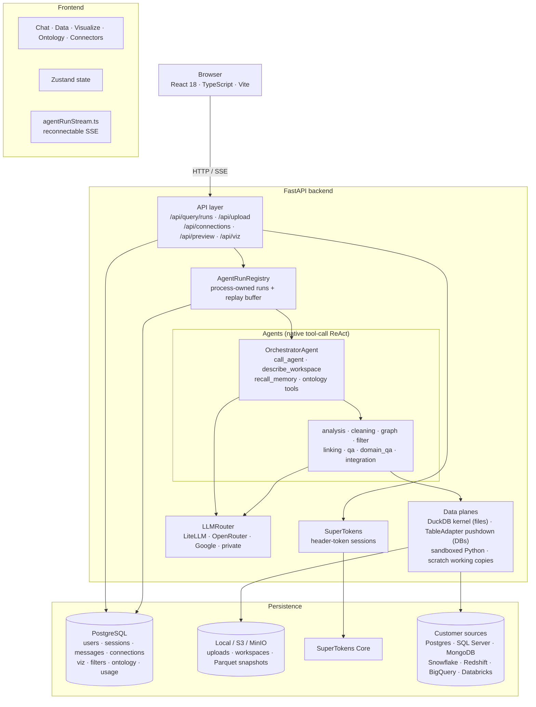

# Stych — AI Data Agent Platform

**Multi-agent workspace for conversational data analysis, cleaning, visualization, and semantic modeling**

[](https://www.python.org/)
[](https://reactjs.org/)
[](https://fastapi.tiangolo.com/)

## Overview

Stych is a full-stack AI platform. You upload files or attach a live database / warehouse table, then chat with your data in natural language. An orchestrator agent delegates to specialist agents (analysis, cleaning, charts, filters, joins, Q&A, integrations) through native LLM tool calls, and every step streams to the browser over reconnectable SSE.

### What you can do

- **Ask analytical questions** — the analysis agent writes and runs Python in a sandbox (files) or read-only SQL / Mongo pipelines (live sources).
- **Build charts** — the graph agent creates persistent `VizSpec` visualizations that appear in the Visualize tab and re-query live data; you can also edit them by hand (drag-and-drop shelves, ECharts renderer).
- **Clean data** — the cleaning agent edits workspace files or Stych-owned SQL / Mongo *working copies*; the source table is never modified, and persistent writes require explicit approval.
- **Highlight rows** — the filter agent saves preview filters (highlight, duplicate detection, conditional formatting) shown in the Data tab; filters never change data.
- **Link datasets** — exact joins run inside the source; fuzzy/lexical strategies (Levenshtein, Jaro-Winkler, token set/sort, TF-IDF, Soundex, Metaphone, …) run in Stych. Plans pause for user confirmation.
- **Model semantics** — define an ontology (entities, relationships, dimensions, certified metrics) that charts and chat share.
- **Use integrations** — Google Sheets/Drive/Docs/Slides, Notion, OpenData, Yahoo Finance via MCP.
- **Run Initial EDA** — an objective-based skill executed by the same orchestrator (`task_type: "eda"`).

---

## Architecture



### Backend

| Layer | Technology |
|---|---|
| Framework | FastAPI (async) + Uvicorn |
| Agent loop | Shared native tool-call ReAct engine (`backend/react_engine/`); agents subclass Google ADK `Agent` |
| LLM routing | LiteLLM (default) · OpenRouter · Google GenAI · private OpenAI-compatible |
| Observability | Langfuse (per-request tracing via `contextvars`) + usage/cost ledger |
| File compute | Per-session locked-down DuckDB kernel + sandboxed Python subprocess |
| Live sources | `TableAdapter` pushdown — preview, filter, diff, export, and charts run in the source |
| Auth | SuperTokens — email/password + Google OAuth (header-token sessions) |
| Streaming | Detached agent runs + reconnectable SSE with `run_snapshot` replay |
| Concurrency | 3 active runs per user (`MAX_CONCURRENT_STREAMS_PER_USER`); one active run per session |
| App DB | PostgreSQL via SQLAlchemy 2 + Alembic |
| Memory | Short-term compaction + optional Hindsight long-term memory |

### Frontend

| Layer | Technology |
|---|---|
| Framework | React 18 + TypeScript + Vite 6 |
| State | Zustand (+ TanStack Query) |
| Charts | ECharts (Visualize tab + chat `VizCard`), Recharts (legacy ```` ```chart ```` fences), Vega-Lite (linking inspect + ```` ```vega ```` fences) |
| Ontology canvas | React Flow (`@xyflow/react`) |
| Auth | SuperTokens React SDK (header-token mode) |
| Markdown | `react-markdown` + `remark-gfm` |
| Contracts | JSON Schemas exported from the backend → generated TS in `src/generated/` |

---

## Quick Start

### Run with Docker (self-hosting)

The fastest way to run everything (app database, SuperTokens auth, LiteLLM gateway, backend, frontend) on one machine:

```bash
cp .env.example .env      # fill in the REQUIRED values and at least one LLM key
docker compose up -d --build
```

Open **http://localhost:8080** (or your `PUBLIC_URL`). Database migrations run automatically each time the backend container starts (`backend/scripts/migrate.py`; set `RUN_MIGRATIONS=false` to skip). To use a different LLM provider, edit `docker/litellm_config.yaml`.

For TLS and a domain, put a reverse proxy in front of the frontend container and set `PUBLIC_URL` to the public `https://` address before building.

### Local development

#### Prerequisites

- Python 3.11+ (`.python-version` pins 3.11)
- Node 20+ / npm 10+
- PostgreSQL (app database)
- SuperTokens Core
- A LiteLLM endpoint (or OpenRouter / Google / private LLM credentials)

#### Backend

```bash
cd backend
pip install -e ".[dev]"   # or: uv sync
cp .env.example .env      # fill in API keys and SECRET_KEY
alembic upgrade head      # run database migrations
python main.py            # or: uvicorn main:app --reload
```

#### Frontend

```bash
cd frontend
npm install
cp .env.example .env
npm run dev
```

Open **http://localhost:5173**. See [`docs/INSTALL.md`](docs/INSTALL.md) for the full reference.

### Environment variables (backend)

| Variable | Description |
|---|---|
| `LITELLM_BASE_URL` / `LITELLM_API_KEY` / `LITELLM_DEFAULT_MODEL` | LiteLLM proxy (default provider) |
| `OPENROUTER_API_KEY` | OpenRouter key (if `llm.provider: openrouter`) |
| `GOOGLE_API_KEY` | Google GenAI key (if `llm.provider: google`; no native tool calling) |
| `SUPERTOKENS_CONNECTION_URI` / `SUPERTOKENS_API_KEY` | SuperTokens Core |
| `GOOGLE_OAUTH_CLIENT_ID` / `GOOGLE_OAUTH_CLIENT_SECRET` | Enables Google sign-in |
| `APP_DATABASE_URL` / `APP_DB_SCHEMA` | App PostgreSQL |
| `SECRET_KEY` | Also derives the Fernet key that encrypts saved credentials — rotating it invalidates them |
| `STORAGE_BACKEND` | `local` (default) or `s3` |
| `S3_ENDPOINT_URL` / `S3_BUCKET` / `S3_ACCESS_KEY` / `S3_SECRET_KEY` | S3 / MinIO |
| `WORKSPACE_BASE` | Override for per-session workspace directory |
| `MAX_CONCURRENT_STREAMS_PER_USER` | Active agent runs per user (default 3) |
| `USAGE_LIMIT_ENABLED` / `USAGE_LIMIT_USD` / `USAGE_LIMIT_EXEMPT_DOMAIN` | Lifetime spend cap (off by default; set `USAGE_LIMIT_ENABLED=true` to enable) |
| `LANGFUSE_PUBLIC_KEY` / `LANGFUSE_SECRET_KEY` / `LANGFUSE_HOST` | Langfuse tracing |
| `HINDSIGHT_ENABLED` / `HINDSIGHT_URL` | Long-term memory |
| `DEV_MODE` | `true` enables `POST /api/auth/dev` (refused when `ENV=production`) |
| `ADMIN_EMAILS` / `ADMIN_USER_IDS` | Admin allowlists (the only admin mechanism) |

---

## Data Sources

Capabilities are declared per connector in `backend/datasources/registry.py`; the generated matrix is [`docs/connector-capabilities.md`](docs/connector-capabilities.md).

### File upload (CSV / Excel / JSON)

Uploads are stored (local or S3), seeded into the session workspace as a lossless Parquet file, and queried through a session-scoped DuckDB kernel. Python analysis/cleaning runs in the workspace sandbox.

### Live databases and warehouses

All database connectors attach **by reference**: Stych reads the schema and an exact row count, and stores the connection (encrypted) — no rows are copied at attach time. Preview, profiling, filters, diffs, exports, charts, and analysis queries are pushed down to the source. Cleaning creates Stych-owned **working copies** in a scratch schema (default `stych_temp`, a scratch database for MongoDB); source tables are never written.

| Connector | Maturity | Authentication |
|---|---|---|
| PostgreSQL | production | Connection URL / user + password |
| SQL Server | beta | User + password |
| MongoDB | beta | Connection URI (schema inferred from samples) |
| Snowflake | beta | Key-pair (JWT) only — paste PEM private key |
| Amazon Redshift | beta | IAM access keys only |
| BigQuery | beta | Service-account JSON (legacy Google OAuth connections are read-only) |
| Databricks | beta | Personal access token only |

Cross-source joins are not supported; same-source joins are.

Connections are saved per user in the **Connectors** page (tags, pinned tables, health checks) and attached to a chat session from the **Add data** dialog.

---

## Project Structure

```
stych/
├── backend/
│   ├── agents/          # orchestrator, analysis, cleaning, graph, filter, linking, qa,
│   │                    # integration, formatter, csv_agent, sql_agent, mongo_agent, base,
│   │                    # state.py, progress.py, run_manager.py, run_executor.py
│   ├── react_engine/    # shared native tool-call ReAct loop + compaction
│   ├── api/             # FastAPI routers (runs, upload, sessions, connections, preview, export, auth)
│   ├── datasources/     # connectors, adapters/ (pushdown), contracts/, registry, sql_dialect
│   ├── execution/       # DuckDB kernel, session data plane, joins
│   ├── viz/             # VizSpec schema, validation, SQL/pandas/Mongo compilers, executor
│   ├── filters/         # FilterSpec, predicate compilers, annotation, services
│   ├── ontology/        # semantic model spec, resolve, executor, viz bridge
│   ├── tools/           # agent toolsets (workspace, analysis, cleaning, sql, viz, ontology, linking, MCP)
│   ├── workspace/       # per-session workspace manager, sandbox runner, sources catalog
│   ├── llm/             # LLMRouter, providers, Langfuse, usage tracking/limits, titles
│   ├── memory/          # short-term compaction + Hindsight long-term memory
│   ├── mcp_infra/       # MCP server registry + client manager
│   ├── database/        # SQLAlchemy models + stores
│   ├── auth/            # SuperTokens init, dev auth
│   ├── helpers/         # agent registry, SSE, storage, crypto, validators
│   ├── config/          # config.yaml, routing_config.yaml, agents.yaml
│   ├── alembic/         # migrations
│   ├── scripts/         # migrate.py (run on container start), export_contract_schemas.py
│   ├── tests/           # pytest suite (+ tests/integration for live engines)
│   └── main.py
├── frontend/
│   └── src/
│       ├── pages/       # Landing, Login, AuthCallback, Chat, Connectors, Settings
│       ├── components/  # chat, shell/, visualize/, preview/, ontology/, connectors/, data/
│       ├── hooks/       # useChat.ts, agentRunStream.ts
│       ├── services/    # api, auth, viz, filters, ontology, sse, storage
│       ├── store/       # useStore.ts, useAuthStore.ts
│       └── generated/   # backend-exported schemas + generated TS contracts
├── docker/              # LiteLLM config for the self-hosted stack
├── docs/
├── sample_data/
├── scripts/             # git hook installer
├── docker-compose.yml   # self-hosted stack
└── .env.example         # settings for docker-compose.yml
```

---

## API

Interactive docs when the backend is running: **http://localhost:8000/docs** (Swagger) and **/redoc**.

Key endpoints:

| Method | Path | Description |
|---|---|---|
| `POST` | `/api/upload` | Upload CSV / Excel / JSON |
| `POST` | `/api/query/runs` | Create (or idempotently reuse) an agent run |
| `GET` | `/api/query/runs/{run_id}/stream` | Attach / reconnect to a run over SSE |
| `POST` | `/api/query/runs/{run_id}/cancel` | Cancel a run |
| `GET` | `/api/query/runs/session/{session_id}` | Latest run for a session |
| `GET/POST/PATCH/DELETE` | `/api/connections…` | Saved connections, pinned tables, attach to session |
| `POST` | `/api/datasources/{connector}/test·tables·load` | Direct connector endpoints |
| `GET` | `/api/preview/sources·page·diff/{session_id}` | Data tab: sources, paged grid, diffs |
| `*` | `/api/viz/…` · `/api/filters/…` · `/api/ontology/…` | Visualizations, saved filters, ontology |
| `GET` | `/api/export/…` | Working data, live source stream, cleaning scripts/files |
| `GET` / `DELETE` | `/api/session/{id}` | Session info / delete session and its artifacts |
| `GET` | `/api/history/{id}` | Conversation history |
| `GET` | `/api/sessions` | Session list with titles |
| `GET` | `/api/health` | Health check |
| `*` | `/auth/*` | SuperTokens-managed auth routes |
| `GET` | `/api/auth/me` | Current user |

---

## SSE Event Protocol

The canonical list is `backend/helpers/sse.py`, exported to `frontend/src/generated/schema/sse_events.json`. Every attachment starts with `run_snapshot`, then live events follow by sequence number.

| Event | UI effect |
|---|---|
| `run_snapshot` | Restore streaming text, trace parts, artifacts, and terminal state after (re)attach |
| `thinking` | Live "agent is working" indicator |
| `part.updated` | Upsert a trace part (agent step / tool call) in the live trace |
| `token` / `thinking_token` | Append answer text / model reasoning |
| `token_retract` | Clear the streaming bubble |
| `viz` / `filter` / `ontology` | Refresh / badge the Visualize, Data, or Ontology tab |
| `compaction_start` / `compaction_end` | Context compaction notice |
| `result` | Commit final assistant message |
| `error` / `timeout` / `limit_reached` / `cancelled` | Terminal states |
| `heartbeat` / `reasoning` | Ignored by the UI |

---

## License

Stych is licensed under the [GNU Affero General Public License v3.0](LICENSE) (`AGPL-3.0-only`).

We develop Stych as an open core: most of the product is open source, and a smaller set of enterprise features is planned as a separate, commercially licensed offering. We also intend to move the open core to a more permissive license (Apache 2.0) in the future. See [`LICENSING.md`](LICENSING.md) for the details and our future intent.

Contributions are welcome. Read [`CONTRIBUTING.md`](CONTRIBUTING.md) and sign the [CLA](CLA.md) before opening a pull request.
