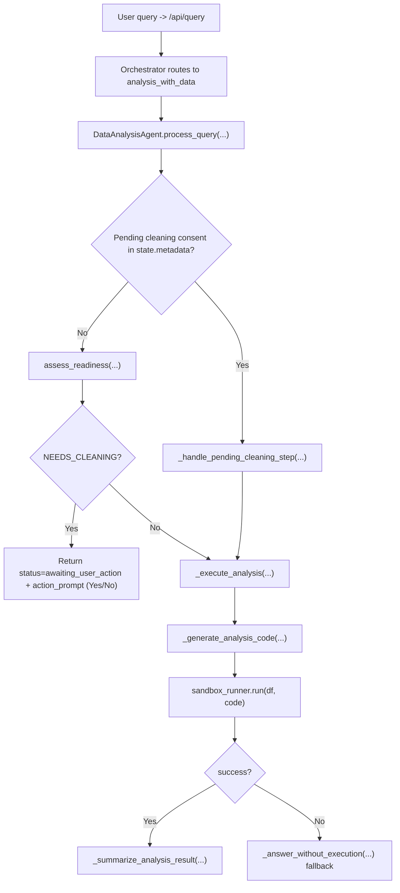

# Analysis Agent Robust Pipeline

> **Historical (superseded, September 2026).** This describes an earlier design.
> - `backend/agents/analysis/sandbox_runner.py` no longer exists; code runs through the shared `backend/workspace/runner.py` (`WorkspaceSandboxRunner`).
> - The orchestrator no longer routes by intent (`analysis_with_data`). It delegates with native `call_agent` tool calls in `backend/react_engine/`.
> - Analysis itself is a native tool-call ReAct loop (`tools/analysis_tools.py`: `run_script`, `run_sql`, `run_pipeline`, working-copy tools, …).
>
> The readiness gate, cleaning consent and raw/working dataframe concepts still apply. See [`../ARCHITECTURE.md`](../ARCHITECTURE.md) for the current design.

This document reflects the implementation of the analysis pipeline at the time it was written.

Primary files:

- `backend/agents/analysis/agent.py`
- `backend/agents/analysis/sandbox_runner.py`
- `backend/agents/state.py`
- `backend/api/schemas.py`
- `backend/api/routes.py`

## Current Goals Implemented

- Pre-analysis readiness gate with states:
  - `READY`
  - `NEEDS_CLEANING`
- Mandatory user consent before cleaning mutation.
- Dual-dataframe model:
  - `raw_dataframe` (baseline)
  - `working_dataframe` (mutable analysis surface)
- Sandboxed code execution for question answering.
- Structured interactive response contract via `action_prompt` + `user_action`.

## Runtime Flow

## Data Model

`DataContext` stores both dataset versions:

- `raw_dataframe`
- `working_dataframe`
- backward-compatible property `dataframe` -> `working_dataframe`

Upload path initializes both as deep copies in:

- `backend/api/routes.py`

Behavior:

- `raw_dataframe` is not mutated by analysis flow.
- `working_dataframe` is what analysis executes against.
- If cleaning succeeds, only `working_dataframe` is replaced.

## Readiness Check

Implemented in `assess_readiness(...)` with helpers:

- `_build_quality_summary(...)`
- `_deterministic_cleaning_needed(...)`
- `_llm_cleaning_judgement(...)`

Decision logic:

- Deterministic quality risk + question sensitivity.
- LLM JSON judgement (`needs_cleaning`, `reason`).
- Final status:
  - `NEEDS_CLEANING` (asks consent)
  - `READY` (run analysis)

## Cleaning Consent State

Pending consent is tracked in `AgentState.metadata` under:

- key: `analysis_pending`
- type: `cleaning_consent`

Stored payload includes:

- `original_question`
- `quality_summary`
- `prompt_id`

When user responds:

- frontend can send structured `user_action`
- agent parses `user_action` first, then falls back to plain text yes/no parsing

If accepted:

- `DataCleaningAgent.clean_data(...)` is called directly from analysis agent.
- If cleaned data is returned, `working_dataframe` is updated.
- If no cleaned data is returned, analysis continues on existing `working_dataframe` with an explicit note.

If declined:

- analysis continues on current `working_dataframe`.

## Analysis Execution

`_execute_analysis(...)` is the core runtime path.

Steps:

1. Generate code with `_generate_analysis_code(...)`
2. Run sandbox via `AnalysisSandboxRunner.run(...)`
3. Summarize execution output with `_summarize_analysis_result(...)`
4. On validation/runtime failure, fallback to `_answer_without_execution(...)`

`_generate_analysis_code(...)` now includes stronger dataset grounding:

- shape
- column names
- dtypes
- preview rows (up to 5)
- instruction for robust string matching / approximate user value mapping

## Sandbox Guardrails

`AnalysisSandboxRunner` enforces:

- AST-based code validation
- import restrictions
- dangerous call/attribute blocks
- isolated subprocess execution with timeout
- structured JSON result contract (`success`, `result`, `stdout`, `error`, `stderr`)

## API Contract (Current)

Request:

- `QueryRequest.user_action` (optional object from button interaction)

Response:

- `QueryResponse.status`
- `QueryResponse.action_prompt` (when waiting for consent)
- `QueryResponse.metadata`

Current status values used by analysis flow:

- `completed`
- `awaiting_user_action`
- `error`

## Function Inventory (DataAnalysisAgent)

Public/entry methods:

- `process_query(...)`: stateful analysis workflow used by orchestrator
- `analyze(...)`: high-level descriptive analysis path (compatibility path)
- `answer_question(...)`: direct endpoint compatibility path

Core private methods:

- `assess_readiness(...)`
- `_handle_pending_cleaning_step(...)`
- `_execute_analysis(...)`
- `_generate_analysis_code(...)`
- `_summarize_analysis_result(...)`
- `_answer_without_execution(...)`

Consent/readiness helpers:

- `_build_quality_summary(...)`
- `_deterministic_cleaning_needed(...)`
- `_llm_cleaning_judgement(...)`
- `_build_cleaning_consent_prompt(...)`
- `_parse_cleaning_decision(...)`

## Configuration Extension Points

Sandbox limits/tools:

- `backend/agents/analysis/sandbox_runner.py`
  - allow/deny lists
  - wrapper limits

Analysis timeout:

- `AnalysisSandboxRunner(timeout_seconds=60)` in `backend/agents/analysis/agent.py`

Cleaning sensitivity policy:

- `_deterministic_cleaning_needed(...)` in `backend/agents/analysis/agent.py`

Codegen context policy:

- `_generate_analysis_code(...)` in `backend/agents/analysis/agent.py`
